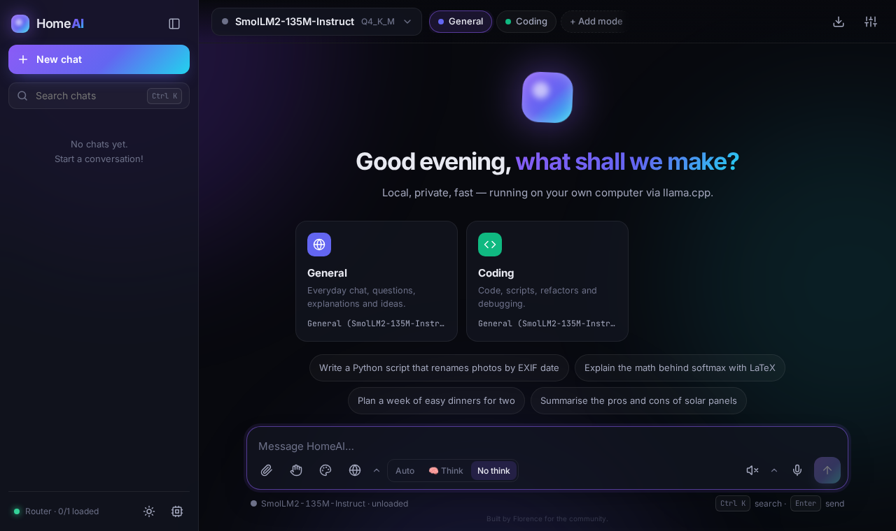

# HomeAI Setup Kit

**A private AI assistant that runs entirely on your own computer.** One setup script looks at your PC, asks a few
plain-English questions, finds AI models on Hugging Face that fit your hardware, and installs a clean, ready-to-use
local AI stack: the [llama.cpp](https://github.com/ggml-org/llama.cpp) engine plus **HomeAI**, a fast browser chat app.

Everything local; no telemetry. Tokens only if the user provides an HF token.

> [!WARNING]
> **Experimental software - new, provided as-is, with no warranty. Use it at your own risk.**
> You are responsible for the models you download and how you use them, and for complying with each model's licence
> and with the laws where you live. **Uncensored models can produce offensive, harmful or inaccurate output.**
> HomeAI has one fixed safety rule that **cannot be removed**: no sexual content involving anyone under 18.
> Please read [DISCLAIMER.md](DISCLAIMER.md).



---

## Contents

- [Features](#features)
- [Requirements](#requirements)
- [Quick start - Windows](#quick-start---windows)
- [Quick start - Linux](#quick-start---linux)
- [Optional components](#optional-components)
- [Adding modes](#adding-modes)
- [Updating models](#updating-models)
- [Starting and stopping](#starting-and-stopping)
- [Uninstall](#uninstall)
- [Privacy and safety](#privacy-and-safety)
- [FAQ](#faq)
- [Licence and credits](#licence-and-credits)

## Features

- **Hardware scan (read-only).** It checks your OS, processor, RAM, graphics card and its memory, free disk space,
  Docker and WSL.
- **The right engine for your hardware.** It downloads the official llama.cpp build for your machine: CUDA for
  NVIDIA, Vulkan for AMD and Intel, or the CPU build. The download is checked against GitHub's published SHA-256.
- **Model search that fits your PC.** It searches Hugging Face for GGUF models and works out how much memory each
  one needs, including the context cache (KV). It picks the best quality level (quant) that fits, and handles
  mixture-of-experts models and vision files.
  - It also shows any refusal numbers the model card reports.
  - By default it suggests uncensored/abliterated models. A **Standard** option is available.
- **Nothing downloads until you type `yes`.** Downloads resume if interrupted and are checked against SHA-256.
- **A clean start.** A fresh install shows only two modes, **General** and **Coding**, plus a **+ Add mode** button.
- **HomeAI chat app features:**
  - Markdown, code highlighting and maths
  - Think / No-think toggle
  - Vision: image input, with a vision model
  - Web search, via your own SearXNG
  - Voice
  - "Send to OpenHands"
  - Scene to Prompt
  - Secure chat delete
  - Automatic routing between your modes
- **Launchers.** Windows shortcuts with icons, Linux menu entries, start/stop scripts, and an uninstaller that asks
  before each delete.

## Requirements

| | Minimum | Recommended |
|---|---|---|
| OS | Windows 10/11 64-bit, or a 64-bit Linux desktop (x86-64; ARM64 CPU builds where llama.cpp publishes them) | Windows 11 or a recent Ubuntu / Fedora |
| Memory | 8 GB RAM (small models, slow) | 16-32 GB RAM, or a graphics card with 8 GB+ video memory |
| Disk | 10 GB free | 50 GB+ free on an SSD |
| Graphics | Not needed (CPU works) | NVIDIA (CUDA), AMD or Intel (Vulkan) with current drivers |
| Software | **Windows:** nothing; setup fetches its own Python. **Linux:** Python 3.9+ (`python3`), plus `python3-venv` for voice | Docker Desktop / Docker Engine for web search and OpenHands |
| Internet | Needed for setup and downloads only | |

No admin or root rights are needed, except for the optional Security Monitor's one-time install.

## Quick start - Windows

1. Download this repository: **Code > Download ZIP**, or `git clone`. Unzip it anywhere.
2. Double-click **`Setup-Windows.cmd`**.
   - If Windows SmartScreen warns you, choose *More info > Run anyway*.
   - Setup downloads a private copy of Python 3.12 (about 15 MB, SHA-256 checked) into the kit folder. It does not
     install Python system-wide.
3. Answer the numbered questions. Press Enter to accept a suggestion.
4. Check the list of downloads, then type **`yes`**.
5. When it finishes, double-click the **HomeAI** desktop shortcut. HomeAI opens at http://127.0.0.1:8090/.

## Quick start - Linux

```bash
git clone <this repository> HomeAI-Setup-Kit
cd HomeAI-Setup-Kit
bash setup-linux.sh
```

Answer the questions, check the download list, and type **`yes`**. Then start HomeAI from your application menu,
or run `~/HomeAI/start-homeai.sh` (the path changes if you picked a different folder). Open http://127.0.0.1:8090/.

For voice on Debian/Ubuntu, first run `sudo apt install python3-venv`.

## Optional components

Setup asks about each of these. Run setup again at any time to add one; your chats and models are kept.

| Component | What it does | Needs |
|---|---|---|
| **Web search (SearXNG)** | Private meta-search on `127.0.0.1:8888`, used by HomeAI's web button. Setup generates a fresh secret key. | Docker |
| **Voice** | Talk to HomeAI and hear its answers. Speech-to-text uses faster-whisper small.en; text-to-speech uses Kokoro. Both run on the CPU, offline. | About 1.2 GB download |
| **OpenHands** | An AI coding agent in a Docker sandbox, at `127.0.0.1:3000`. It is wired to your local model, has analytics off, and can only see `extras/openhands/workspace`. | Docker, about 3.5 GB image |
| **Model Updater** | Checks Hugging Face for better models for your installed modes. It swaps a model only after you type yes, can undo a swap, and offers to delete unused models one by one. | - |
| **Security Monitor** (Windows, advanced) | Background watcher. It closes AI programs that reach the internet without approval and warns about port scans, screen capture and changes to HomeAI's files. Uses Sysmon and offline DB-IP country files, both downloaded when you run its installer. | One admin run of `extras\security\Install-All.cmd` |

## Adding modes

You get **General** and **Coding** to start with. To add more, click **+ Add mode** in HomeAI, or run
*Add a mode* from the Start menu or `add-mode.sh`. The modes are Writing, Vision, Reasoning, Research,
Long documents, Image prompts, Captions, Music and Android.

1. Choose the mode. If a model is gated, you can paste a Hugging Face token; it is used for that search and download
   only and is never saved.
2. HomeAI shows up to three models that fit your computer, with the size, the reasons each was picked and any
   warnings. You can also reuse a model you already have.
3. Type **yes** to download. The new mode button appears when the download finishes.

## Updating models

- **Windows:** use the *HomeAI Model Updater* shortcut.
- **Linux:** run `extras/model-updater/run-model-updater.sh`.

The updater shows better matches for each installed mode and switches a mode only after you type yes. The old model
is kept so you can **undo** the switch. Use *Delete models no mode uses* to free disk space; it asks before each file.

To update the llama.cpp engine itself, run setup again. It keeps your models and chats.

## Starting and stopping

| | Windows | Linux |
|---|---|---|
| Start | *HomeAI* shortcut or `Start HomeAI.cmd` | menu entry or `./start-homeai.sh` |
| Stop | *Stop HomeAI* shortcut or `Stop HomeAI.cmd` | `./stop-homeai.sh` |

Everything listens on `127.0.0.1` only, so no other device on your network can connect. Logs are in `logs/` and
are overwritten each time HomeAI starts.

## Uninstall

- **Windows:** run *Uninstall HomeAI* from the Start menu.
- **Linux:** run `./uninstall.sh` in your HomeAI folder.

The uninstaller asks before each delete:

- shortcuts
- Docker containers and images
- models
- your chats
- the OpenHands workspace
- the rest of the folder

Anything you don't confirm stays where it is. If you installed the Security Monitor, first run
`Uninstall-Watcher-Task.cmd` and `Uninstall-Sysmon.cmd` from `extras\security` as administrator.

## Privacy and safety

- **Everything local; no telemetry.** HomeAI, the engine and the extras run on your computer and listen on
  127.0.0.1. OpenHands analytics are switched off. SearXNG runs as a private instance.
- **Network use.** The kit only goes online for:
  - the downloads you approve: GitHub (llama.cpp, Kokoro), Hugging Face (models, Whisper), nuget.org (Python on
    Windows), PyPI (voice packages) and Docker registries
  - web searches you start
  - update checks you run
- **Tokens only if the user provides an HF token.** The token is kept in memory for the current search or download
  and is never written to disk.
- **The fixed safety rule.** The HomeAI server adds one rule to every chat request: no sexual content involving
  anyone under 18. It cannot be removed in the app. HomeAI adds no other restriction.
- The HomeAI server forwards only chat, tokenize and model load/unload requests to the engine. All other engine
  endpoints are blocked.

## FAQ

**Which models will I get?**
Whatever fits your hardware best on the day you run setup. The kit contains no model list. It searches Hugging Face
live and ranks GGUF models by fit, quality, popularity, uploader and (in uncensored mode) published refusal numbers.

**What does "uncensored / abliterated" mean?**
These models have had their refusal behaviour reduced, so they answer more directly. They can also be wrong or
offensive more often. Choose **Standard** during setup if you prefer the makers' original safety tuning. You can mix
both kinds across modes.

**It's slow. What can I do?**
- Pick *Fast* during setup, or use a smaller model with *Add mode*.
- Lower the context size in `engine/models.ini`.
- On a laptop, make sure the dedicated graphics card is used and its drivers are current.
- Without a graphics card, expect a few words per second from mid-size models.

**My GPU wasn't detected.**
Update the graphics driver and run setup again. NVIDIA needs a recent driver for the CUDA build. AMD and Intel use
Vulkan, which ships with current drivers. Setup falls back to the CPU build if needed.

**Can I use my own GGUF file?**
Yes. Add a `[section]` to `engine/models.ini` with `model = <path to the .gguf file>`, then reload HomeAI. You can
also point an existing mode at it with *Add mode > Use a model you already have*.

**Can I access HomeAI from my phone?**
Not by default; everything is bound to 127.0.0.1 for safety, and HomeAI has no login of its own. If you really need
it, reach your PC through a private VPN or an SSH tunnel rather than opening HomeAI to your network.

**Where are my chats?**
In `homeai/data/` inside your HomeAI folder. *Secure delete* overwrites a chat file before removing it.

**Do I need Docker?**
Only for web search and OpenHands. Everything else works without it.

**Can I move the HomeAI folder?**
Run setup again and choose the new folder. Paths in `engine/models.ini` and `install.json` are absolute.

**How do I report a problem?**
Open an issue with your OS, your graphics card and the relevant lines from `logs/`. Please remove any personal
information first.

## Licence and credits

- Released under the [MIT licence](LICENSE), copyright Florence and contributors.
- Third-party components are listed with their licences in [THIRD_PARTY_NOTICES.md](THIRD_PARTY_NOTICES.md).
- The repository contains no executables and no model files; they are downloaded from their official sources at
  install time.
- Thanks to the llama.cpp, Hugging Face, SearXNG, OpenHands, faster-whisper and Kokoro projects, and to everyone who
  publishes open models.

---

<sub>Built by Florence for the community.</sub>
